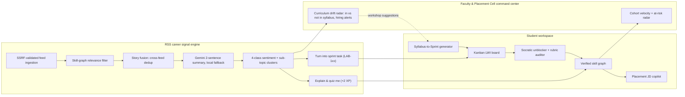

# CampusFlow AI — *The Agile Campus Operating System*

**Turning static college syllabi and industry signals into agile Learning Work Items (LWIs), Socratic AI tutoring, verified Skill Graphs, and institutional Curriculum Drift intelligence.**

| | |
| --- | --- |
| 🌐 **Live Deployed App** | `[Insert Live Frontend URL]` |
| ⚙️ **Live API Health** | `[Insert Live Backend URL]/health` (interactive `/docs` runs locally; production builds hide it) |
| 🎯 **Hackathon Track** | Theme 2 — *AI for Education* (Prompt War 2026) |
| 🔑 **Demo sign-in** | One-click buttons on the login page, or password `CampusFlow@2026` |


---

## 1. The Problem: Why Campus Portals Fail

1. **Fragmented execution.** Syllabi live in static PDFs, deadlines scatter across WhatsApp groups, and labs are tracked in spreadsheets. No one can see the work as a whole.
2. **Silent failure and copy-paste AI.** Generic LLM wrappers hand out finished answers, which kills real learning. Faculty find struggling students only after internal exams.
3. **Placement and curriculum disconnect.** Placement cells shortlist on raw CGPA instead of verified skills, and syllabi trail industry shifts by years.

## 2. Our Solution: Closed-Loop Campus Intelligence

CampusFlow AI connects four loops that today run apart:

**Classroom execution → skill verification → industry signals → curriculum updates**

A syllabus becomes a sprint. Mastered tickets become evidence on a skill graph. The news a student follows becomes labs and quizzes on that same graph. The cohort's reading trends tell faculty what the syllabus is missing.



Every AI call goes through one guarded path: untrusted text is redacted, wrapped, and sent to Gemini. The reply must pass a Pydantic schema, or a deterministic engine answers instead. The UI never waits on a model that is down.

## 3. Core Features (Testable Live)

### A. Agile academic execution — "Jira for higher education"
- **Syllabus-to-Sprint generator:** Paste a syllabus and Gemini breaks it into `EPIC`, `TASK`, and `SUBTASK` LWIs, with story points, CO/PO tags, rubric criteria, and prerequisite links (`POST /api/v1/sprints/generate`).
- **Kanban board:** Tickets move through `BACKLOG → IN_PROGRESS → AI_REVIEW → MASTERED`.
- **Prerequisite blocker:** A ticket cannot start until its prerequisite is mastered. Example: `CS301-106 Query optimization` stays locked until `CS301-104 SQL joins lab` is mastered.

### B. Anti-cheating Socratic unblocker and rubric evaluator
- **Unblocker:** Returns a diagnosed gap and one guiding question, never code. If Gemini's reply looks like a solution (code fences, `SELECT`, `def`, long blocks), it is discarded and a per-skill Socratic prompt is used instead.
- **Rubric auditor:** Scores a draft against the ticket's rubric (`readiness_score` from 0 to 100), with a pass/fail note per criterion.
- **Direct-solution requests are refused:** The API strips PII and files a 15-minute remediation `SUBTASK` instead of handing over the answer.

### C. Live verified skill graph and placement JD copilot
- **Evidence-backed skill nodes:** A node rises only when a linked ticket reaches `MASTERED` and carries evidence hashes.
- **Placement view:** The Placement Cell filters students by a verified-skill bar and keeps CGPA visible, so a high grade without proof stands out.
- **JD copilot:** Matches a job description against verified scores and injects a **14-day prep sprint** (`PLACE-1xx` tickets) onto the board.

### D. Closed-loop RSS reading and career signal assistant
- **Story fusion:** When a second feed carries the same story, it merges into the saved one. The test is at least 3 shared stemmed title words and 60% overlap. The card shows *"Reported by 2 sources"* with each outlet's link.
- **Explainable relevance:** Up to 3 badges per story, for example *"Matches your active ticket CS301-104"*, *"Closes a skill gap: FastAPI (58)"*, or *"Placement prep: FastAPI is 33% of your sprint"*.
- **Signal-to-action:**
  - **"Turn into sprint task"** has Gemini plan a 2-to-4-hour micro-lab. It lands in the Backlog of a *Reading labs* sprint as `LAB-1xx`, with a skill tag mapped onto the graph. The same story never creates a second task.
  - **"Explain & quiz me"** opens a 2-minute card: core concept, real-world use, and one check question. Grading happens on the server, and the first correct answer adds **+2 XP** to an existing skill node.
- **Curriculum drift radar** (faculty and TPO): Trending skills are shown as *In syllabus* or *Not in syllabus* bars, with workshop suggestions. Critical alerts fire when, for example, a quarter of hiring news reads negative. **No student names are exposed.**

Each interest also has **Stories**, **Sentiment** (Positive / Watchful / Critical / Neutral, with a donut chart and a sortable table), and **Topics** (keyword sub-clusters) tabs. Feeds refresh every 8 hours, and a manual re-check inside that window returns `409` with `Retry-After`.

## 4. 90-Second Judge Walkthrough

Open the live app. The **sign-in page** has one-click demo accounts for Arjun K. (student), Dr. Meenakshi (faculty), and the Placement Cell. Use **Sign out** in the top bar to change accounts.

1. **Student Kanban and Socratic tutor (25s).** Sign in as **Arjun K.** Open the **CS301** sprint and note that `CS301-106` is locked behind `CS301-104`. Open `CS301-104 SQL joins lab`, then the **Rubric** tab, and run **Strong draft** to get a 0–100 score. Then run **Direct solution**: it is refused, PII is stripped, and a remediation ticket is filed.
2. **RSS intelligence and story fusion (30s).** Open **My interests**. The top card is the FastAPI outage story, badged *"Closes a skill gap: FastAPI (58)"*. Click **Explain & quiz me** and answer correctly for **+2 XP to FastAPI**. Then click **Add interest**, add the **Machine Learning** sample, then **Machine learning research**. The handwritten-digits story now shows *"Reported by 2 sources"*. Check the **Sentiment** and **Topics** tabs.
3. **Signal-to-lab (15s).** On the LoRA story, click **Turn into sprint task**, then **open board**. The new `LAB-1xx` ticket sits in the Backlog of **Reading labs**.
4. **Placement copilot and command center (20s).** As Arjun, run **Placement copilot** on the sample SDE-1 description to inject a 14-day prep sprint. Sign out, then sign in as **Dr. Meenakshi**: Priya Nair and Vikram Singh are flagged at risk, and the **Curriculum drift radar** sits above the cohort table, with a critical *"Hiring news is turning critical"* alert. Sign in as **Placement Cell** to see Rohan Mehta's high CGPA next to a low verified score.

## 5. Alignment with the Judging Criteria

| Criterion | Proof in the system |
| --- | --- |
| **Innovation & Creativity** | News a student follows becomes graded labs and XP on their own skill graph (signal → `LAB-1xx` → mastery). Cross-feed story fusion. A drift radar that turns cohort reading into curriculum feedback. |
| **Problem Relevance** | Replaces PDF syllabi and spreadsheets with a sprint board. Refuses copy-paste answers and coaches with Socratic questions. Flags at-risk students from sprint velocity before exams. Replaces CGPA screens with verified skill evidence. |
| **Technical Implementation** | FastAPI + Pydantic v2 schemas on every model reply. Two-model Gemini chain with a deterministic fallback. SSRF-hardened feed fetcher. Hashed sessions with role-based access. 64 backend tests, plus clean `tsc` and production build. |
| **Practical Impact** | Works with no API key (deterministic engine), so it survives outages and zero budget. Uses public RSS feeds and one-click demo accounts. Ships with a Dockerfile, a Cloud Run-ready image, and an audit trail of every AI action. |

## 6. Engineering Quality, Security, and Production Resilience

- **SSRF and network hardening** (`backend/app/services/signals.py`):
  - Only `http`/`https` URLs are accepted, and URLs with embedded credentials are refused.
  - `localhost`, `*.local`, `*.internal`, and `metadata.google.internal` are blocked.
  - Every resolved address must be globally routable, so RFC 1918 ranges, loopback, and link-local `169.254.169.254` are refused.
  - Each of up to 4 redirects is re-validated, and the connected peer is re-checked to close DNS rebinding.
  - Proxy environment variables are ignored, downloads stop at 500 KB, and feeds that declare `DOCTYPE`/`ENTITY` are refused.
- **Multi-tier LLM resilience** (`backend/app/services/ai.py`):
  - The model chain is `GEMINI_MODEL` (`gemini-flash-latest`), then `GEMINI_FALLBACK_MODEL` (`gemini-flash-lite-latest`), then a deterministic local engine.
  - A model returning `429`/`5xx` rests for 5 minutes, and a reply that fails its Pydantic schema is retried once.
  - RSS summaries fall back to an extractive two-sentence summary labeled **"Quick summary"**.
  - Explainers cached during an outage upgrade to Gemini when next opened, unless the quiz is already passed.
- **Prompt-injection and integrity guardrails** (`backend/app/security/`):
  - Syllabi, submissions, job descriptions, and RSS article text are neutralized and wrapped in `<student_submission>` delimiters.
  - Generated hints are scanned for solution code.
  - Quiz answer keys never leave the server, and grading always uses the stored card, so a cached upgrade can't change an answer mid-attempt.
- **Authentication and access control:**
  - Passwords are salted `scrypt` hashes. Session tokens are random and stored only as SHA-256 hashes, last `SESSION_HOURS`, and are revoked on sign-out.
  - The role comes from the account, never from the browser, and wrong email and wrong password get the same answer.
- **Privacy by design:** Emails, phone numbers, and roll numbers are redacted before any model call. The drift radar and topic pulse aggregate across the cohort and never show names.
- **Operational safety:**
  - Rate limits: AI routes 10/min, feed fetches 6/min, login 5/min.
  - Security headers: `nosniff`, `X-Frame-Options: DENY`, `no-referrer`.
  - CORS uses an allow-list, and `/docs` is hidden in production.
  - The container runs as a non-root user, and every AI action writes an audit event.
- **Tests:** `pytest` gives **64 passing backend tests**, covering SSRF cases, redirects, oversized feeds, entities, injection, RBAC, sessions, story fusion, idempotent tasks, quiz XP, the drift radar, the dashboard, the cold-start demo data, and a simulated Gemini 503 across every AI feature. TypeScript `tsc --noEmit` and `next build` pass clean.

## 7. Tech Stack and Local Setup

| Layer | Technology |
| --- | --- |
| Frontend | Next.js 15 (App Router), React 19, TypeScript, Tailwind CSS 3, lucide-react |
| Backend | FastAPI 0.115, Pydantic v2, SQLAlchemy 2, slowapi, httpx, Uvicorn |
| AI / LLM | Google Gemini REST (`gemini-flash-latest` → `gemini-flash-lite-latest`) with schema validation and a deterministic fallback |
| Database | SQLite (WAL mode); any SQLAlchemy URL through `DATABASE_URL` |
| Deployment | `backend/Dockerfile` (Python 3.12-slim, non-root, port 8080), `docker-compose.yml`, Cloud Run for the API, Vercel for the web app |

### Project structure

```
CampusFlow AI/
├── docker-compose.yml          # API container on localhost:8000
├── backend/
│   ├── Dockerfile
│   ├── .env.example            # copy to .env
│   ├── requirements.txt
│   ├── pytest.ini
│   ├── app/
│   │   ├── main.py             # app, CORS, security headers, 8-hour feed loop
│   │   ├── config.py           # settings from environment
│   │   ├── database.py         # engine, migrations, seeding
│   │   ├── models.py  schemas.py  limiter.py
│   │   ├── routers/
│   │   │   ├── api.py          # sprints, LWIs, AI actions, placement, faculty, TPO
│   │   │   ├── auth.py         # login, me, logout
│   │   │   └── signals.py      # interests, stories, task, explain, quiz, drift
│   │   ├── security/           # auth, PII redaction, injection guard, pipeline
│   │   └── services/           # ai, board, blocker, dashboard, seed, signals, story_actions
│   └── tests/                  # test_auth, test_core, test_dashboard, test_signals, test_story_actions
└── frontend/
    ├── app/                    # page.tsx (auth gate), layout.tsx, error.tsx
    ├── components/             # AppShell, LoginView, KanbanBoard, SignalsView, DriftRadar, ...
    └── lib/                    # api.ts, session.ts, types.ts, format.ts
```

### Quickstart (Windows PowerShell; on macOS or Linux use `.venv/bin/python`)

**Backend** (http://127.0.0.1:8000):

```powershell
cd backend
python -m venv .venv
.\.venv\Scripts\python -m pip install -r requirements.txt
Copy-Item .env.example .env        # optionally set GEMINI_API_KEY
.\.venv\Scripts\python -m uvicorn app.main:app --reload --port 8000
```

The first start creates `campusflow.db`, seeds the cohort, and creates the three demo logins.

**Run the test suite** (64 tests):

```powershell
cd backend
.\.venv\Scripts\python -m pytest -q
```

**Frontend** (http://localhost:3000), in a second terminal:

```powershell
cd frontend
npm install
npm run dev
```

### Environment variables

| Variable | Where | Default | Purpose |
| --- | --- | --- | --- |
| `GEMINI_API_KEY` | backend | empty | Turns on Gemini. Without it, every feature uses the deterministic engine. |
| `GEMINI_MODEL` / `GEMINI_FALLBACK_MODEL` | backend | `gemini-flash-latest` / `gemini-flash-lite-latest` | Model chain |
| `DATABASE_URL` | backend | `sqlite:///backend/campusflow.db` | SQLAlchemy URL |
| `ALLOWED_ORIGINS` | backend | `http://localhost:3000,http://127.0.0.1:3000` | CORS allow-list |
| `ENVIRONMENT` | backend | `development` | `production` hides `/docs` and `/openapi.json` |
| `DEMO_PASSWORD` | backend | `CampusFlow@2026` | Password for the 3 demo accounts. Empty skips them. |
| `SESSION_HOURS` | backend | `12` | Session lifetime |
| `ALLOW_PERSONA_HEADER` | backend | `false` | Test-only `X-Persona` shortcut. Keep it off anywhere real. |
| `NEXT_PUBLIC_API_BASE` | frontend | `http://127.0.0.1:8000` | API URL used by the browser |
| `NEXT_PUBLIC_DEMO_PASSWORD` | frontend | `CampusFlow@2026` | Demo buttons on the sign-in page. Empty hides them. |

### Docker and deployment

```powershell
docker compose up --build          # API on http://localhost:8000 (container port 8080)
```

- **API → Cloud Run:** Build from `backend/Dockerfile`. Set `GEMINI_API_KEY`, `ALLOWED_ORIGINS`, and `DEMO_PASSWORD`. The image sets `ENVIRONMENT=production`.
- **Web → Vercel:** Deploy `frontend/` with `NEXT_PUBLIC_API_BASE` set to the API URL, and add the web origin to `ALLOWED_ORIGINS`.

### API surface

| Method | Path | Access |
| --- | --- | --- |
| GET | `/health` | public |
| POST | `/api/v1/auth/login` · GET `/api/v1/auth/me` · POST `/api/v1/auth/logout` | public / signed in |
| GET | `/api/v1/bootstrap` · `/api/v1/security/posture` | signed in |
| GET | `/api/v1/dashboard` | student |
| POST | `/api/v1/sprints/generate` · `/api/v1/sprints/{id}/tickets` | student |
| GET | `/api/v1/sprints/{id}/board` · `/api/v1/lwi/{id}` | student |
| PATCH | `/api/v1/lwi/{id}/status` | student |
| POST | `/api/v1/lwi/{id}/unblock` · `/api/v1/lwi/{id}/evaluate` | student |
| POST | `/api/v1/placement/analyze-jd` | student |
| GET | `/api/v1/students/{id}/skill-graph` | self, faculty, TPO |
| GET | `/api/v1/faculty/cohort-health` | faculty |
| GET | `/api/v1/tpo/readiness` | TPO, faculty |
| GET / POST / DELETE | `/api/v1/signals` · `/api/v1/signals/feeds` · `/api/v1/signals/feeds/{id}` | student |
| GET | `/api/v1/signals/feeds/{id}/analysis` | student |
| POST | `/api/v1/signals/briefing` · PATCH `/api/v1/signals/messages/{id}/read` | student |
| POST | `/api/v1/signals/messages/{id}/task` · `/explain` · `/quiz` | student |
| GET | `/api/v1/signals/drift` · `/api/v1/signals/pulse` | faculty, TPO |
| POST | `/api/v1/security/preview` | signed in |

### Known limits before a real campus rollout

- **Database:** SQLite on Cloud Run is lost on restart, so point `DATABASE_URL` at Postgres.
- **Feed polling:** The 8-hour feed loop runs inside the API process. Move it to Cloud Scheduler when running more than one instance.
- **Sign-in:** Replace the shared demo password with per-user credentials, password reset, and campus SSO.
- **Dependencies:** Upgrade to Next.js 16 to clear the PostCSS advisory `npm audit` reports inside Next 15.
