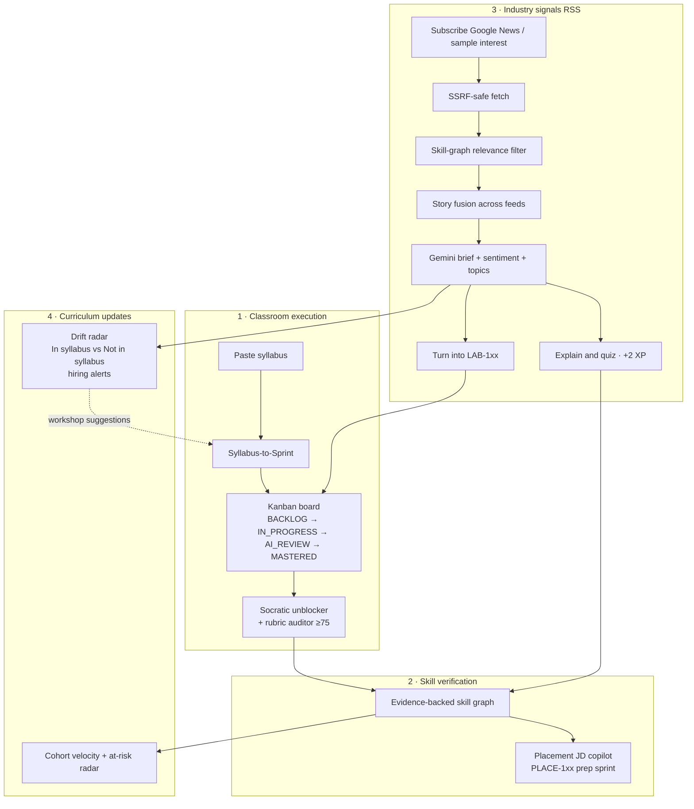
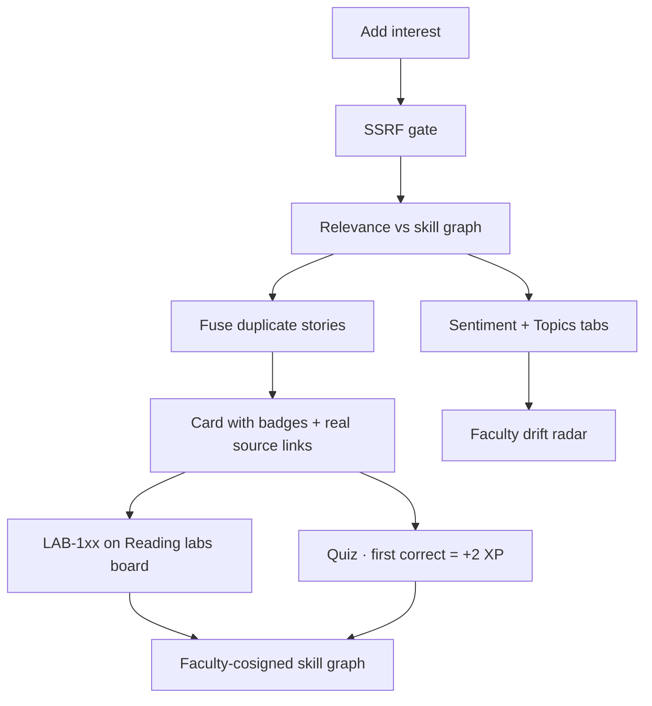

# CampusFlow AI — *The Agile Campus Operating System*

**Closed loop for AI × Education:** Syllabus → Agile LWIs → Anti-cheating Socratic tutor → AI review + faculty co-sign → Industry RSS fusion → `LAB-1xx` labs + Curriculum Drift Radar.

| | |
| --- | --- |
| 🎯 **Hackathon Track** | Theme 2 — *AI for Education* (Prompt War 2026) |
| 🌐 **Live Deployed App** | https://campusflow-ai-five.vercel.app |
| 🩺 **API health** | https://campusflow-api-598899050820.asia-south1.run.app/health |
| 📑 **Pitch deck (PDF)** | [Download / read CampusFlow_AI_Pitch_Deck.pdf](./pitch/CampusFlow_AI_Pitch_Deck.pdf) — features, workflows, architecture |
| ⚡ **60-second judge path** | Open the live app → **Arjun** → My interests → **Explain & quiz me** on the FastAPI card → switch **Faculty** / **Placement** in the top bar |
| 🔁 **Instant Persona Switcher** | Top bar: **Arjun / Faculty / Placement** — one click, seeded data, no re-signup |
| 🔑 **Demo password** | `CampusFlow@2026` (one-click buttons on the login page) |
| 🧪 **Evidence** | **82+** backend tests · `tsc` + `next build` clean · SSRF + session auth + Gemini 503 fallbacks |
| 📦 **Source** | https://github.com/ramasamyp-aiengineer/campusflow-ai |


---

## 1. The Problem: Why Campus Portals Fail

1. **Fragmented execution.** Syllabi live in static PDFs, deadlines scatter across WhatsApp groups, and labs are tracked in spreadsheets. No one can see the work as a whole.
2. **Silent failure and copy-paste AI.** Generic LLM wrappers hand out finished answers, which kills real learning. Faculty find struggling students only after internal exams.
3. **Placement and curriculum disconnect.** Placement cells shortlist on raw CGPA instead of recorded skill evidence, and syllabi trail industry shifts by years.

## 2. Our Solution: Closed-Loop Campus Intelligence

CampusFlow AI connects four loops that today run apart:

**Classroom execution → skill verification → industry signals → curriculum updates**

A syllabus becomes a sprint. Mastered tickets become evidence on a skill graph. The news a student follows becomes labs and quizzes on that same graph. The cohort's reading trends tell faculty what the syllabus is missing.



| Loop | What happens | Judge-visible proof |
| --- | --- | --- |
| **1 Classroom** | Syllabus → sprint tickets → Socratic coach + rubric score | CS301 board, locked `CS301-106`, Strong draft ≥75 |
| **2 Skills** | Scored mastery writes evidence onto the skill graph | FastAPI / SQL nodes; Placement shortlist by verified skill |
| **3 Signals** | RSS → filter → fuse → `LAB-1xx` or quiz XP | My interests · FastAPI card · ML fusion · LoRA lab |
| **4 Curriculum** | Cohort reading trends → drift + hiring alerts | Faculty drift radar · *"Hiring news is turning critical"* |

Every AI call goes through one guarded path: untrusted text is redacted, wrapped, and sent to Gemini. The reply must pass a Pydantic schema, or a deterministic engine answers instead. The UI never waits on a model that is down.

## 3. Core Features (Testable Live)

### A. Agile academic execution — "Jira for higher education"
- **Syllabus-to-Sprint generator:** Paste a syllabus and Gemini breaks it into `EPIC`, `TASK`, and `SUBTASK` LWIs, with story points, CO/PO tags, rubric criteria, and prerequisite links (`POST /api/v1/sprints/generate`).
- **Kanban board:** Tickets move through `BACKLOG → IN_PROGRESS → AI_REVIEW → MASTERED`.
- **Prerequisite blocker:** A ticket cannot start until its prerequisite is mastered. Example: `CS301-106 Query optimization` stays locked until `CS301-104 SQL joins lab` is mastered.

### B. Anti-cheating Socratic unblocker and rubric evaluator
- **Unblocker:** Returns a diagnosed gap and one guiding question, never code. Heuristic output checks (case-insensitive SQL/code patterns, fences, long blocks, and `actionable_fixes`) discard model text that looks like a finished answer; phrase-based refusal catches common "do it for me" asks. These are heuristics, not a perfect jailbreak wall.
- **Rubric auditor:** Scores a draft against the ticket's rubric (`readiness_score` from 0 to 100), with a pass/fail note per criterion.
- **Direct-solution requests are refused:** The API strips PII and files a 15-minute remediation `SUBTASK` instead of handing over the answer.

### C. Live verified skill graph and placement JD copilot
- **Evidence-backed skill nodes:** Skills rise only after an AI-reviewed submission clears readiness ≥ 75. Dragging into AI Review or Mastered without that score is refused. Each awarded ticket is recorded once with a SHA-256 evidence hash, so the same ticket cannot farm proficiency.
- **Placement view:** The Placement Cell filters students by a verified-skill bar and keeps CGPA visible, so a high grade without proof stands out.
- **JD copilot:** Matches a job description against verified scores and injects a **14-day prep sprint** (`PLACE-1xx` tickets) onto the board.

### D. Closed-loop RSS reading and career signal assistant

**End-to-end workflow (subscribe → filter → fuse → act → verify → drift):**

1. **Subscribe** — Student adds a Google News RSS URL or a one-click sample interest (`Machine Learning`, `Machine learning research`, Placements, Databases). Cold-start demo already seeds Arjun with a live Google News SQL/FastAPI/placements feed plus a FastAPI outage card.
2. **SSRF gate** — Only `http`/`https`, no credentials, no localhost / `.internal` / metadata hosts, no proxy env, 500 KB cap, XML entities refused.
3. **Ingest + skill filter** — Items are scored against the student's verified skill graph and open LWIs. Irrelevant campus noise (sports, canteen) stays low; FastAPI / SQL / OS stories surface first.
4. **Story fusion** — When a second feed carries the same story (≥3 shared stemmed title words and 60% overlap), it merges. The card shows *"Reported by 2 sources"* with **real outlet links** (docs, LWN, Hugging Face, scikit-learn, etc.—not placeholder domains).
5. **Explainable relevance** — Up to 3 badges per story, e.g. *"Matches your active ticket CS301-104"*, *"Closes a skill gap: FastAPI (58)"*, *"Placement prep: FastAPI is 33% of your sprint"*.
6. **Signal → lab** — **Turn into sprint task** has Gemini plan a 2–4 hour micro-lab → Backlog of *Reading labs* as `LAB-1xx` with a skill tag on the graph. Same story never creates a second task.
7. **Signal → XP** — **Explain & quiz me** opens a 2-minute card (concept, real-world use, one check). Server-side grading; first correct answer adds **+2 XP** to an existing skill node (no farming).
8. **Interest analytics** — Each interest has **Stories**, **Sentiment** (Positive / Watchful / Critical / Neutral + donut + sortable table), and **Topics** (keyword clusters).
9. **Institutional loop** — Faculty / Placement **Curriculum drift radar**: trending skills as *In syllabus* vs *Not in syllabus*, workshop suggestions, critical hiring alerts (e.g. when ~25% of hiring news is negative). **No student names.**
10. **Refresh cadence** — Feeds re-poll every 8 hours; a manual re-check inside that window returns `409` with `Retry-After`.



## 4. 90-Second Judge Walkthrough

**Live demo:** https://campusflow-ai-five.vercel.app · password `CampusFlow@2026`

| One-click persona | Email | Role |
| --- | --- | --- |
| **Arjun K.** | `arjun@campusflow.edu` | Student · seeded board + RSS interests |
| **Dr. Meenakshi** | `meenakshi@campusflow.edu` | Faculty · cohort health + drift radar |
| **Placement Cell** | `placement@campusflow.edu` | TPO · verified-skill shortlist |

1. Click **Arjun K.** on the login page (or any demo button). Inside the app, the top-bar **Instant Persona Switcher** (`Arjun` / `Faculty` / `Placement`) flips roles in one click—sessions stay authenticated; boards stay seeded.
2. **Student Kanban and Socratic tutor (25s).** Open the **CS301** sprint. `CS301-106` is locked behind `CS301-104`. Open `CS301-104`, **Rubric** tab → **Strong draft** (0–100). Then **Direct solution**: refused, PII stripped, remediation ticket filed. Skills only rise after readiness ≥ 75.
3. **RSS intelligence (30s).** Open **My interests**. Top card = FastAPI outage with *"Closes a skill gap: FastAPI (58)"* — open the story link (real FastAPI security docs). **Explain & quiz me** → correct answer → **+2 XP to FastAPI**. Add **Machine Learning** + **Machine learning research** samples → handwritten-digits shows *"Reported by 2 sources"* with real MNIST / PyTorch links. Check **Sentiment** and **Topics**.
4. **Signal-to-lab (15s).** On the LoRA story (Hugging Face PEFT docs) → **Turn into sprint task** → **open board** → `LAB-1xx` in **Reading labs** Backlog (second click does not duplicate).
5. **Institutional views (20s).** Switch to **Faculty**: at-risk students + **Curriculum drift radar** with *"Hiring news is turning critical"* (no student names). Switch to **Placement**: high CGPA vs low verified skill on Rohan Mehta.

## 5. Alignment with the Judging Criteria

| Criterion | Proof in the system |
| --- | --- |
| **Innovation & Creativity** | News a student follows becomes graded labs and XP on their own skill graph (signal → `LAB-1xx` → mastery). Cross-feed story fusion. A drift radar that turns cohort reading into curriculum feedback. |
| **Problem Relevance** | Replaces PDF syllabi and spreadsheets with a sprint board. Refuses copy-paste answers and coaches with Socratic questions. Flags at-risk students from sprint velocity before exams. Replaces CGPA screens with verified skill evidence. |
| **Technical Implementation** | FastAPI + Pydantic v2 schemas on every model reply. Two-model Gemini chain with a deterministic fallback. SSRF-hardened feed fetcher. Hashed sessions with role-based access. 71 backend tests, plus clean `tsc` and production build. |
| **Practical Impact** | Instant Persona Switcher (Student / Faculty / Placement) on a rich seeded campus. Works with no API key (deterministic engine). Public RSS, Dockerfile, Cloud Run-ready image, audit trail on every AI action. |

## 6. Engineering Quality, Security, and Production Resilience

- **SSRF and network hardening** (`backend/app/services/signals.py`):
  - Only `http`/`https` URLs are accepted, and URLs with embedded credentials are refused.
  - `localhost`, `*.local`, `*.internal`, and `metadata.google.internal` are blocked.
  - Every resolved address must be globally routable, so RFC 1918 ranges, loopback, and link-local `169.254.169.254` are refused.
  - Each of up to 4 redirects is re-validated, and the connected peer is re-checked to close DNS rebinding.
  - Proxy environment variables are ignored, downloads stop at 500 KB, and feeds that declare `DOCTYPE`/`ENTITY` are refused.
- **Multi-tier LLM resilience** (`backend/app/services/ai.py`):
  - The model chain is `GEMINI_MODEL` (`gemini-flash-latest`), then `GEMINI_FALLBACK_MODEL` (`gemini-flash-lite-latest`), then a deterministic local engine.
  - A model returning `429`/`5xx` rests for 5 minutes, and a reply that fails its Pydantic schema is retried once.
  - RSS summaries fall back to an extractive two-sentence summary labeled **"Quick summary"**.
  - Once an explainer card is issued it is frozen so a later Gemini recovery cannot move the answer key mid-quiz.
- **Prompt-injection and integrity guardrails** (`backend/app/security/`):
  - Syllabi, submissions, job descriptions, and RSS article text are neutralized and wrapped in `<student_submission>` delimiters.
  - Generated hints and fixes are scanned for solution-shaped text on unblock and evaluate replies.
  - Quiz answer keys never leave the server. Fallback answer positions are derived from `APP_SECRET`, not the public message id, and a wrong answer locks the card briefly. Grading always uses the frozen stored card; reopening explain cannot change the answer mid-attempt.
- **Authentication and access control:**
  - Passwords are salted `scrypt` hashes. Session tokens are random and stored only as SHA-256 hashes, last `SESSION_HOURS`, are revoked on sign-out, and expired/revoked rows are purged.
  - The role comes from the account, never from the browser, and wrong email and wrong password get the same answer.
- **Privacy by design:** Emails, phone numbers, and roll numbers are redacted before any model call. The drift radar and topic pulse aggregate across the cohort and never show names.
- **Operational safety:**
  - Rate limits cover AI actions, feed mutations, ticket creation, status changes, read receipts, and login. Signed-in limits use a hash of the session token instead of a spoofable forwarded IP.
  - Security headers: `nosniff`, `X-Frame-Options: DENY`, `no-referrer`.
  - CORS and Host headers use exact allow-lists, and `/docs` is hidden in production.
  - The digest-pinned container runs as a non-root user, exposes a health check, and every AI action writes an audit event.
- **Tests:** `pytest` gives **82 passing backend tests**, covering SSRF cases, redirects, oversized feeds, entities, injection, RBAC, sessions, story fusion, idempotent tasks, quiz XP, mastery farming paths, the drift radar, the dashboard, the cold-start demo data, and a simulated Gemini 503 across every AI feature. Frontend adds Vitest unit tests, a11y contracts, `tsc --noEmit`, and `next build`.

## 7. Tech Stack and Local Setup

| Layer | Technology |
| --- | --- |
| Frontend | Next.js 15 (App Router), React 19, TypeScript, Tailwind CSS 3, lucide-react |
| Backend | FastAPI 0.165, Starlette 1.10, Pydantic v2, SQLAlchemy 2, slowapi, httpx, Uvicorn |
| AI / LLM | Google Gemini REST (pinned stable model ids with cooldown + deterministic fallback) with schema validation and a deterministic fallback |
| Database | SQLite (WAL mode); any SQLAlchemy URL through `DATABASE_URL` |
| Deployment | `backend/Dockerfile` (Python 3.12-slim, non-root, port 8080), `docker-compose.yml`, Cloud Run for the API, Vercel for the web app |

### Project structure

```
CampusFlow AI/
├── docker-compose.yml          # API container on localhost:8000
├── backend/
│   ├── Dockerfile
│   ├── .env.example            # copy to .env
│   ├── requirements.txt
│   ├── pytest.ini
│   ├── app/
│   │   ├── main.py             # app, CORS, security headers, 8-hour feed loop
│   │   ├── config.py           # settings from environment
│   │   ├── database.py         # engine, migrations, seeding
│   │   ├── models.py  schemas.py  limiter.py
│   │   ├── routers/
│   │   │   ├── api.py          # sprints, LWIs, AI actions, placement, faculty, TPO
│   │   │   ├── auth.py         # login, me, logout
│   │   │   └── signals.py      # interests, stories, task, explain, quiz, drift
│   │   ├── security/           # auth, PII redaction, injection guard, pipeline
│   │   └── services/           # ai, board, blocker, dashboard, seed, signals, story_actions
│   └── tests/                  # test_auth, test_core, test_dashboard, test_signals, test_story_actions
└── frontend/
    ├── app/                    # page.tsx (auth gate), layout.tsx, error.tsx
    ├── components/             # AppShell, LoginView, KanbanBoard, SignalsView, DriftRadar, ...
    └── lib/                    # api.ts, session.ts, types.ts, format.ts
```

### Quickstart (Windows PowerShell; on macOS or Linux use `.venv/bin/python`)

**Backend** (http://127.0.0.1:8000):

```powershell
cd backend
python -m venv .venv
.\.venv\Scripts\python -m pip install -r requirements-dev.txt
Copy-Item .env.example .env        # optionally set GEMINI_API_KEY
.\.venv\Scripts\python -m uvicorn app.main:app --reload --port 8000
```

The first start creates `campusflow.db`, seeds the cohort, and creates the three demo logins.

**Run the test suite** (82 backend tests):

```powershell
cd backend
.\.venv\Scripts\python -m pytest -q
```

**Frontend** (http://localhost:3000), in a second terminal:

```powershell
cd frontend
npm install
npm run dev
```

### Environment variables

| Variable | Where | Default | Purpose |
| --- | --- | --- | --- |
| `GEMINI_API_KEY` | backend | empty | Turns on Gemini. Without it, every feature uses the deterministic engine. |
| `GEMINI_MODEL` / `GEMINI_FALLBACK_MODEL` | backend | `gemini-3.5-flash-lite` / `gemini-2.5-flash-lite` | Pinned model chain. Aliases containing `latest` are refused in production. |
| `DATABASE_URL` | backend | `sqlite:///backend/campusflow.db` | SQLAlchemy URL |
| `ALLOWED_ORIGINS` | backend | `http://localhost:3000,http://127.0.0.1:3000` | CORS allow-list |
| `ALLOWED_HOSTS` | backend | live API host plus local/test hosts | Exact Host-header allow-list |
| `ENVIRONMENT` | backend | `development` | `production` hides `/docs` and `/openapi.json` |
| `DEMO_PASSWORD` | backend | local demo / required in prod | Powers demo accounts and `/api/v1/auth/demo-switch`. Never expose via `NEXT_PUBLIC_*`. |
| `APP_SECRET` | backend | local demo value | Server-only quiz secret; a non-default value is required in production |
| `SESSION_HOURS` | backend | `12` | Session lifetime |
| `ALLOW_PERSONA_HEADER` | backend | `false` | Test-only `X-Persona` shortcut. Keep it off anywhere real. |
| `NEXT_PUBLIC_API_BASE` | frontend | `http://127.0.0.1:8000` | API URL used by the browser |
| Demo sign-in | frontend + backend | server `DEMO_PASSWORD` | Production uses `/api/v1/auth/demo-switch`; never put the password in `NEXT_PUBLIC_*`. |

### Docker and deployment

```powershell
$env:APP_SECRET = python -c "import secrets; print(secrets.token_urlsafe(48))"
$env:DEMO_PASSWORD = "choose-a-non-default-password"
docker compose up --build          # API on http://localhost:8000 (container port 8080)
```

- **API → Cloud Run (live):** https://campusflow-api-598899050820.asia-south1.run.app — build from `backend/Dockerfile`. Set `GEMINI_API_KEY`, `ALLOWED_ORIGINS`, `ALLOWED_HOSTS`, `DEMO_PASSWORD`, and `APP_SECRET`. The image sets `ENVIRONMENT=production`.
- **Web → Vercel (live):** https://campusflow-ai-five.vercel.app — deploy `frontend/` with Node 24.22.1 and `NEXT_PUBLIC_API_BASE=https://campusflow-api-598899050820.asia-south1.run.app`.

### API surface

| Method | Path | Access |
| --- | --- | --- |
| GET | `/health` | public |
| POST | `/api/v1/auth/login` · GET `/api/v1/auth/me` · POST `/api/v1/auth/logout` | public / signed in |
| GET | `/api/v1/bootstrap` · `/api/v1/security/posture` | signed in |
| GET | `/api/v1/dashboard` | student |
| POST | `/api/v1/sprints/generate` · `/api/v1/sprints/{id}/tickets` | student |
| GET | `/api/v1/sprints/{id}/board` · `/api/v1/lwi/{id}` | student |
| PATCH | `/api/v1/lwi/{id}/status` | student |
| POST | `/api/v1/lwi/{id}/unblock` · `/api/v1/lwi/{id}/evaluate` | student |
| POST | `/api/v1/placement/analyze-jd` | student |
| GET | `/api/v1/students/{id}/skill-graph` | self, faculty, TPO |
| GET | `/api/v1/faculty/cohort-health` | faculty |
| GET | `/api/v1/tpo/readiness` | TPO, faculty |
| GET / POST / DELETE | `/api/v1/signals` · `/api/v1/signals/feeds` · `/api/v1/signals/feeds/{id}` | student |
| GET | `/api/v1/signals/feeds/{id}/analysis` | student |
| POST | `/api/v1/signals/briefing` · PATCH `/api/v1/signals/messages/{id}/read` | student |
| POST | `/api/v1/signals/messages/{id}/task` · `/explain` · `/quiz` | student |
| GET | `/api/v1/signals/drift` · `/api/v1/signals/pulse` | faculty, TPO |
| POST | `/api/v1/security/preview` | signed in |


### Evaluation readiness

| Dimension | What changed for a high score |
| --- | --- |
| Code quality | AI routes offload Gemini/RSS work with `asyncio.to_thread`; sprint/bootstrap queries are batched |
| Security | Trusted hosts, production boot guards, bounded email regex, defused XML, patched FastAPI/Starlette/Next |
| Efficiency | View-scoped polling (~60s), session-keyed rate limits, GUID batching on RSS ingest |
| Testing | 82 backend pytest cases; frontend typecheck + a11y contracts + Vitest unit tests in CI |
| Accessibility | Kanban Move control + keyboard, chart semantics, skip link, focus-visible, reduced motion |
| Problem alignment | Closed loop retained: syllabus → board → AI review → faculty co-sign → verified skills |

### Production scale-up notes

- Point `DATABASE_URL` at Postgres for multi-instance Cloud Run (SQLite is ideal for the hackathon demo).
- Move the 8-hour feed poller to Cloud Scheduler when running more than one API replica.
- Swap shared `DEMO_PASSWORD` for campus SSO when leaving the judge demo.
- Production is already wired: `ALLOWED_ORIGINS=https://campusflow-ai-five.vercel.app` and `NEXT_PUBLIC_API_BASE=https://campusflow-api-598899050820.asia-south1.run.app`.
